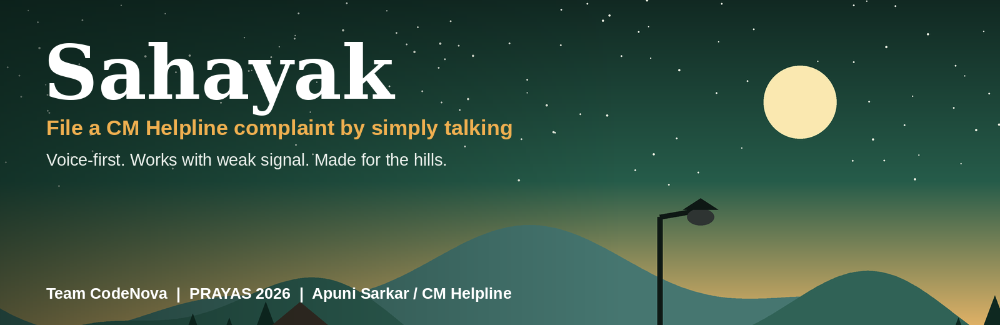
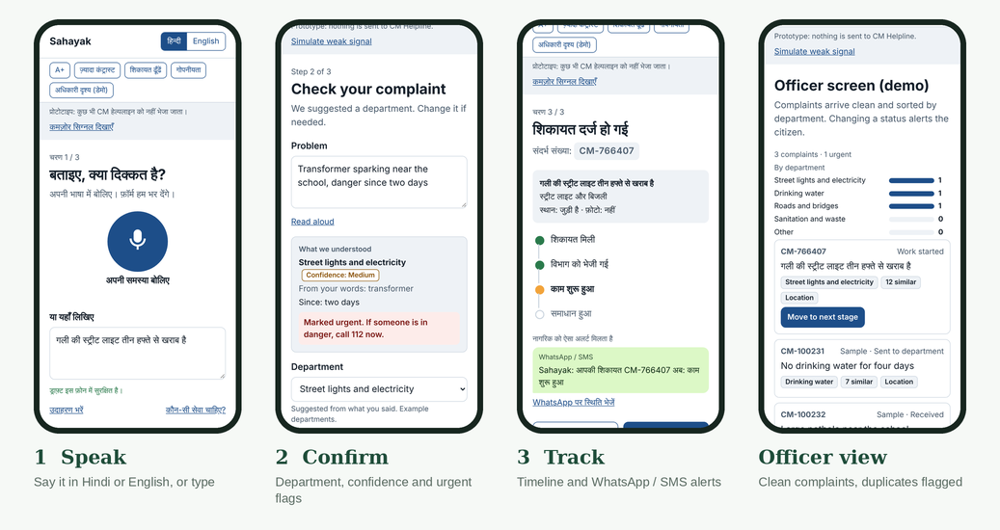
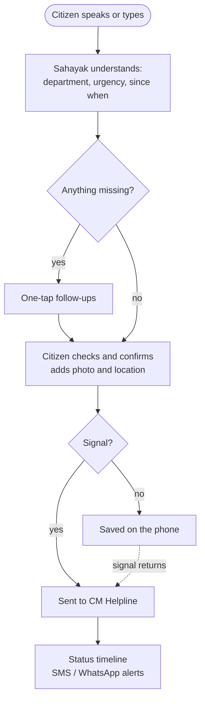
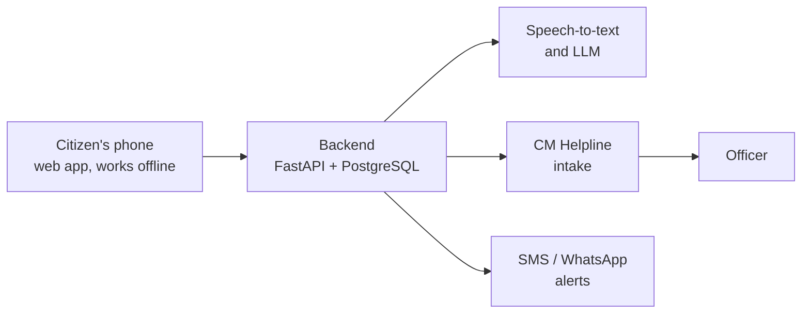

  

  

  
  
  
  
  

> **Team CodeNova** · **Sneha Sharma**, B.Tech 3rd year, Graphic Era Hill University, Dehradun

Sahayak is a voice-first, mobile-first layer on top of CM Helpline. A citizen speaks or types the problem in their own language, the form fills itself, and she only has to confirm. If the signal drops, nothing is lost. It works with the existing CM Helpline process, so officials need no new system.

---

## The problem

Kamla Devi is 62 and lives in a hill village. The street light outside her house has been dead for three weeks. She has a smartphone, but the complaint form is long and in formal language, and the signal keeps dropping. **So she gives up.** *(An imagined example, based on problems citizens commonly face.)*

| What goes wrong | Who it hurts |
|---|---|
| Forms are text-heavy and in formal Hindi or English | Elderly citizens, first-time smartphone users |
| People don't know which department their issue belongs to | Everyone, so complaints get mis-filed or abandoned |
| After filing, there is no simple way to see progress | Everyone |
| Weak networks make forms fail midway and typed text is lost | Hill and remote districts |

## The solution: Speak. Confirm. Track.

  

## Features

| Feature | What it does |
|---|---|
| **Voice or text in Hindi and English** | Speak your problem, or just type it |
| **Explainable routing** | Shows the suggested department, a confidence level and the words behind it. The citizen can change it |
| **Urgent cases** | Words like fire, sparking or accident mark it urgent and show a "call 112" prompt |
| **Smart follow-ups** | Asks where and since when, with one-tap choices |
| **Offline drafts** | Drafts are saved on the phone as you type. A complaint filed offline is sent automatically when signal returns |
| **Photo compression** | A photo is shrunk on the phone before sending (a 5.7 MB photo became about 260 KB in testing) |
| **Status timeline and alerts** | Received, sent to department, work started, resolved, with an SMS / WhatsApp alert preview |
| **Track and share** | Look up a complaint by reference number, and share its status on WhatsApp |
| **Which service do I need?** | Points to the right Apuni Sarkar service, or to a complaint |
| **Accessibility** | Read aloud, three text sizes, high-contrast mode, screen-reader labels |
| **Privacy screen** | Says what is kept and deletes all data from the phone in one tap |
| **Officer view (demo)** | Clean complaints with department, urgent, duplicate, photo and location flags, plus a department chart. Changing a status updates the citizen's timeline |

## How it fits CM Helpline

Nothing is replaced. Sahayak sits in front of CM Helpline and sends the same complaint officers already get.

## What the panel asked for, and where to find it

| Criterion | How Sahayak answers it |
|---|---|
| **Citizen-centricity** | Built around real barriers: language, not knowing the department, no visibility, weak signal |
| **Ease of use** | Three steps: speak, confirm, track. Target of under 60 seconds is a design goal, still to be tested with real users |
| **Innovation** | Routing that explains itself, urgent-case detection, an offline queue that sends later, follow-up questions |
| **Impact** | Fewer abandoned and mis-filed complaints, and a visible status for the citizen |
| **Technical feasibility** | Uses existing technology: speech-to-text, an LLM, local storage, SMS and WhatsApp APIs |
| **Scalability** | Stateless backend that scales by adding servers. Speech and LLM calls are the costly part |
| **Integration** | Sits in front of CM Helpline. The officer view shows what officials would see. A pre-filled handoff is the fallback if no API is available at first |
| **Accessibility** | Read aloud, large text, high contrast, Hindi and English |
| **Prototype quality** | Live, clickable and working end to end, including offline mode |

## What's real and what's simulated

I want this to be clear, so nothing is overstated.

| Real in the prototype | Simulated or not built yet |
|---|---|
| Offline drafts that send later | SMS and WhatsApp alerts (shown on screen) |
| Photo compression on the phone | Keyword routing instead of an LLM |
| Read aloud, text sizes, high contrast | Duplicate counts and sample complaints |
| Status timeline and officer view (stored on the phone) | The connection to CM Helpline |
| Link to the real Apuni Sarkar portal | Garhwali and Kumaoni voice |

**Not done yet:** testing with real users.

## Try it

**[Open the live prototype](https://snehasharmaa912-ops.github.io/CodeNova/prototype/)** on any phone. Chrome on Android also gives voice input.

1. Tap the mic, or "Fill an example"
2. Look at the confidence and urgent flags
3. Tap "Simulate weak signal", then submit. The complaint is saved and sent when signal returns
4. Open "Officer view" and move it forward, then check the citizen's timeline

To run it on your own computer, open `prototype/index.html` in a browser. The offline cache needs it served over http, for example `python -m http.server` inside the `prototype` folder.

## Roadmap

| Month | Focus |
|---|---|
| 1 | Hindi voice-to-complaint demo, screens refined with feedback |
| 2 | Garhwali and Kumaoni voice samples, pilot with real users in a hill district |
| 3 | CM Helpline integration and WhatsApp alerts |

**Planned stack:** React / PWA, Flutter, FastAPI, PostgreSQL, a speech-to-text model and an LLM.

## Files

| File | What it is |
|---|---|
| `CodeNova.pptx` | Pitch deck |
| `prototype/index.html` | Clickable prototype |
| `prototype/sw.js` | Service worker, so the prototype loads offline |
| `docs/` | Images used in this README |

## Contact

Sneha Sharma · snehasharmaa912@gmail.com · [LinkedIn](https://linkedin.com/in/snehasharmaa2006) · [GitHub](https://github.com/snehasharmaa912-ops)
